# OpenCRBOT architecture

## Goal

สร้าง runtime แบบ modular ที่รับภาพจาก Google Play Games on PC Developer Emulator ผ่าน ADB และค่อยเพิ่ม public-screen perception, policy และ verified actions. Runtime ต้องใช้งาน capture/replay ได้แม้ไม่มี model, GPU หรือ memory access.

## Data flow

```mermaid
flowchart LR
    EMU[Google Play Games Dev Emulator] -->|ADB serial localhost:6520| ADB[ADB adapter]
    ADB --> CAP[Frame capture + timestamp]
    CAP --> REC[Session recorder]
    CAP --> VIS[Vision providers]
    VIS --> OBS[Versioned public observation]
    OBS --> POL[Policy interface]
    POL --> GATE[Freshness/confidence/action gate]
    GATE --> ACT[ADB action adapter]
    ACT --> VER[Visual action verification]
    VER --> REC
    OBS --> SIM[Offline evaluation adapter]
    SIM --> POL
```

โค้ดปัจจุบันทำถึง capture/recording, one-frame vision และ non-executable recommendation เท่านั้น กล่อง action gate, device action, verification และ simulator ในภาพเป็นเป้าหมายสถาปัตยกรรมที่ยังไม่ได้ implement

## Module boundaries

| Module | Responsibility | Input/output |
|---|---|---|
| `adb.py` | Find ADB, enumerate/connect devices, capture PNG | ADB byte output / `Device` records |
| `capture` (next milestone) | Timestamp and identify each frame; handle stalls | PNG + serial + monotonic timestamp |
| `vision.py` (MVP; domain validation pending) | One-frame YOLO detections, card-template similarity, rough elixir estimate, overlay | `PublicObservation` + provenance |
| `contracts` (next milestone) | Stable public observation and action schemas | Versioned dataclasses/JSON |
| `policy.py` (MVP; conservative hint only) | A small defensive rule for visible threats | Observation → non-executable recommendation |
| `actions` (next milestone) | Validate, dispatch and verify action | Proposal → result event |
| `replay` (next milestone) | Save frames, observations, decisions and outcomes | JSONL manifest + image artifacts |
| `evaluation` (later) | Run policies against saved captures/offline engine | Paired metrics and regression report |

Policies cannot call ADB directly. This keeps reasoning testable and lets a simulator or a replay feed the same contract.

## Observation contract

Each value should carry:

- `value`: typed value or `null` when not known;
- `source`: screen region/detector/provider identifier;
- `confidence`: calibrated probability-like score in `[0, 1]`;
- `observed_at`: monotonic timestamp for freshness;
- `status`: `observed`, `inferred`, or `unknown`.

The current vision provider emits `inferred` values only, including the battle-screen color heuristic. YOLO scores, template similarity and pixel-bar ratio are not calibrated probabilities for the GPGPC target.

Screen-derived information is the default. Opponent hand/next card is never represented as exact unless a valid public event proves the play; elixir inference remains an interval/estimate. No guessed value may be serialized as exact.

The board coordinate frame is normalized with own king at the bottom: `x,y ∈ [0,1]`. A separate calibrated transform maps board positions to screen pixels; it records orientation, crop and screen dimensions so a display layout change invalidates calibration.

## Reliability rules

1. Every frame has a monotonic sequence, serial, capture time and hash. A stale/repeated frame cannot trigger a new decision.
2. Unknown values stay unknown. A confidence score without target-domain calibration is not permission to act.
3. The current policy emits a human-readable recommendation only. A future action adapter must validate screen bounds and available UI state before dispatch.
4. Each dispatched action is verified from a later frame. Rejected/ambiguous actions are logged and do not update opponent-cycle or strategy state as if accepted.
5. Disconnects, unsupported game identity, schema mismatch and stale calibration fail closed to capture-only mode.
6. Session logs are bounded/rotated; secrets, account identifiers and emulator image contents are not copied into diagnostic manifests.

## Source adapters

### Screen adapter (default)

ADB on Developer Emulator or a user-provided ADB endpoint. Root is not required for standard ADB screenshot and input commands. This is portable across game updates but depends on visual calibration and detector quality.

### Memory adapter (not implemented)

Would require a separately maintained profile with exact package/build/ABI fingerprints, positive canaries and permission to access the target process. An unsupported or absent profile must disable the adapter. `cr-memory-reader`'s current x86_64 guide references a profile file not included in the cloned tree, so its offsets are not an OpenCRBOT dependency.

## Policy and training strategy

Start with deterministic, explainable rules from visible state. Add model inference only behind the policy interface. A model is loadable only when its manifest matches observation schema, action schema, card vocabulary, game/card-data version and checksum. Training requires captured/replay data with labels or an offline simulator adapter; training results are evaluated on held-out matches/captures before becoming the default.

The FirstLight/RoyaleFish V4 policy is coupled to native engine contracts and card catalogs; the ClashAI model uses a different schema and RoyaleSim. Those weights are not assumed compatible with screenshot observations.

## Emulator targets

1. **Developer Emulator:** primary target; Google documents ADB at `localhost:6520`.
2. **Patched Production client:** optional ADB endpoint, selected explicitly; OpenCRBOT does not patch the client.
3. **Other Android devices/emulators:** use a provided ADB serial; screen calibration is per device.

Developer and consumer GPGPC instances cannot run concurrently. Root/partition patching remains outside this repo's install/launch path.
